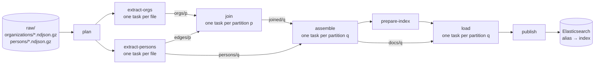

# people-index

people-index joins a feed of person records with a feed of organization records and publishes
the result as one searchable Elasticsearch index behind an alias. Each person document carries
the full records of the organizations its roles point at, plus which references did not
resolve.

It is a staged pipeline written in Rust. Every stage is a set of independent, idempotent tasks
over hash partitions; the only shared state is an S3-compatible object store; workers can be
added or lost at any point. The join is a partitioned hash join, so no node ever holds the
whole organization table, and more data means more partitions rather than bigger machines.

## How it works



1. **plan** lists the inputs and fixes the partition count `P` (a power of two, sized from the
   input bytes) and the index name.
2. **extract** parses each gzip file, quarantines malformed lines, and writes organizations by
   `p = hash(org_id) % P`, persons by `q = hash(person_id) % P`, and one edge per
   (organization, person) reference by `p`.
3. **join** loads one organization partition into memory (last record wins on duplicate ids)
   and streams that partition's edges past it, re-keying the results by person.
4. **assemble** groups one person partition's joined rows, picks each person's last record,
   and builds the final documents.
5. **prepare-index**, **load** and **publish** create a fresh index with load-time settings,
   bulk-load every document, check the count, restore serving settings and move the alias in
   one atomic request. A failed run never touches the alias.

Between stages, rows are stored as zstd-compressed segment files in the object store. A task
writes under its own attempt id and commits by creating one object with a create-if-absent
write; readers list commits, never data, so a retried or duplicated task can never be counted
twice. In a distributed run, workers claim tasks through leases kept in the same store, and a
dead worker's task is taken over when its lease expires.

### Deployment

```
                  ┌──────────────────── Kubernetes (k3d: 1 server + 3 agents, zones a/b/c) ───┐
                  │                                                                           │
                  │   Job pi-run-<id>        Job pi-worker-<id> (parallelism N,               │
                  │   coordinator ─────┐     spread across zones and nodes)                   │
                  │                    │      worker  worker  worker ...                      │
                  │                    ▼        │       │       │                             │
                  │   SeaweedFS (S3) ◄──────────┴───────┴───────┘   commits, leases,          │
                  │   s3:8333                                       segments, inputs          │
                  │                    │        │       │       │                             │
                  │                    ▼        ▼       ▼       ▼                             │
                  │   Elasticsearch (ECK): 3 dedicated masters, data nodes in 3 zones,        │
                  │   shard allocation awareness, TLS, a least-privilege pipeline user        │
                  └───────────────────────────────────────────────────────────────────────────┘
```

Docker Compose runs the same shape on one host: three Elasticsearch nodes (one per zone
attribute), SeaweedFS, one coordinator and `--scale worker=N`.

## Quick start

Both paths need Docker and GNU make (and bash). `make help` lists every target;
[docs/OPERATIONS.md](docs/OPERATIONS.md) explains each one.

**Docker Compose** (memory limits in `deploy/compose/.env.example`: 3 × 1 GiB Elasticsearch,
3 × 2 GiB workers, 1 GiB coordinator):

```bash
make image          # build people-index:local
make compose-run    # Elasticsearch x3 + SeaweedFS, generate data, distributed run, verify
make compose-down   # stop, keep the data (make compose-clean deletes it)
```

Size the synthetic data with `DATAGEN_PERSONS`, `DATAGEN_ORGANIZATIONS`, `DATAGEN_FILES`,
`DATAGEN_SEED` and the workers with `WORKERS` (`make compose-run WORKERS=6`).

**Kubernetes on k3d** (k3d 5 and kubectl; Docker needs at least 10 GiB of memory for the local
overlay):

```bash
make k3d-up         # cluster "people-index": 1 server + 3 agents in zones a/b/c
make eck            # ECK operator and CRDs (pinned by checksum)
make image image-import
make deploy-local   # credentials, Elasticsearch, SeaweedFS, network policies; waits for green
make datagen        # Job: synthetic feeds into s3://people-index/raw/
make run            # coordinator Job + worker Job; waits until the run publishes
make k3d-down
```

Every kubectl call passes `--context k3d-people-index`; nothing acts on your current context.
`make verify` on k3d is not wired up yet (see [Limitations](#limitations)).

**Without Docker**, the offline stages run on a local directory, which is a quick way to look at
the intermediate data:

```bash
cargo build --release -p people-index
export PI_STORE_URL=./store PI_METRICS_ADDR=off PI_LOG_FORMAT=pretty
target/release/people-index datagen --persons 2000 --organizations 500 --files 2 --seed 7
for s in plan extract-orgs extract-persons join assemble; do
  target/release/people-index stage "$s" --run-id demo
done
```

A full local run (`people-index run`) also needs an Elasticsearch at `PI_ES_URL`.

## Design in brief

[docs/ARCHITECTURE.md](docs/ARCHITECTURE.md) is the contract: data, stages, storage layout,
commit and lease protocol, crates, configuration, commands, metrics. The main decisions and
their trade-offs are recorded as ADRs:

| ADR | decision |
|---|---|
| [0001](docs/adr/0001-rust.md) | Rust for the pipeline |
| [0002](docs/adr/0002-partitioned-hash-join.md) | a partitioned hash join instead of a shared lookup store |
| [0003](docs/adr/0003-object-store-commits-and-leases.md) | commits and leases as conditional writes in the object store; no coordinator database |
| [0004](docs/adr/0004-eck-multi-node-elasticsearch.md) | multi-node Elasticsearch on ECK, load-time settings, alias publishing |
| [0005](docs/adr/0005-staged-intermediate-data.md) | persisted intermediate data: segments of postcard rows in zstd |

The workspace:

| crate | role |
|---|---|
| `pi-model` | rows, envelope parsing, partitioner, last-wins, document builder (no I/O) |
| `pi-segment` | the segment file format |
| `pi-store` | object store wrapper with conditional writes; every path in one place |
| `pi-coord` | `Stage` / `Executor`, commits, leases, local and distributed executors, resume |
| `pi-es` | Elasticsearch client, bulk indexer, index admin, publisher, verifier, mapping |
| `pi-stages` | the eight stages |
| `pi-datagen` | seeded synthetic feeds and their exact `expected.json` |
| `people-index` | the binary: `run`, `worker`, `datagen`, `verify`, `stage` |

## Data

Inputs are gzipped NDJSON, one envelope per line:
`{"id": <u64 or decimal string>, "updated_at": ..., "record": {...}}`. Organization records
carry name, domain, industry, location, size, keywords and funding; person records carry
profile fields, skills and `roles[]`, each role with an `organization_id` that may be null.
Unknown fields pass through untouched. Lines that do not parse, or whose `id` or `record` is
invalid, are quarantined with file, line and reason; a run fails only past `PI_MAX_MALFORMED`
per feed.

Each output document is the person record plus:

- `organizations[]`: the full record of each distinct resolved organization, in role order;
- `roles[].organization_resolved`: `true` or `false`, absent when the id is null;
- `unresolved_organization_ids[]`: ids that did not resolve, absent when there are none.

Duplicate ids resolve to the last record in feed order (files by name, then line), whatever
the partition or worker count. The document `_id` is the person id. The mapping is explicit
(`dynamic: false`) and lives in [crates/pi-es/src/mapping.json](crates/pi-es/src/mapping.json)
with its reasons in [mapping.md](crates/pi-es/src/mapping.md).

## Configuration

Every option is a flag and a `PI_*` environment variable; the full table, with defaults, is in
[ARCHITECTURE.md, Configuration](docs/ARCHITECTURE.md#configuration). The ones you are most
likely to touch: `PI_STORE_URL`, `PI_S3_ENDPOINT`, `PI_ES_URL` and its credentials,
`PI_EXECUTOR` (`local` or `distributed`), `PI_CONCURRENCY`, `PI_PARTITION_TARGET_BYTES`,
`PI_SENDERS_PER_WORKER` and `PI_BULK_MAX_BYTES`. Sizing advice is in
[OPERATIONS.md, Sizing](docs/OPERATIONS.md#sizing).

## Testing

```bash
make check    # fmt, clippy -D warnings, all tests, deploy manifests, forbidden-word scan
```

- **Unit and property tests** in each crate: partitioning (range, splitting when `P`
  doubles), the document builder (unknown fields kept, order, counts, never panics on
  arbitrary input), segment round trips and damage detection (truncation at every byte, bit
  flips, bad magic, oversized lengths).
- **Store conformance** for memory, local and S3 backends, and lease and commit races. The S3
  cases run when `PI_TEST_S3_ENDPOINT` points at an S3-compatible server; they have passed
  against SeaweedFS 4.48.
- **Executors** with fake stages: retries, permanent errors, panics, cancellation, three
  workers on one run, two workers racing for one task, lease takeover after a crash, stage
  timeout, and resume after a crash or a failure.
- **Elasticsearch** behaviour against a mock HTTP server: bulk splitting, partial failures
  resending only failed items, 429 backoff, incomplete shard responses, publish order, and a
  count mismatch that never moves the alias.
- **End to end on a local store**: a generated data set with raised malformed, duplicate and
  unresolved rates goes through every offline stage; the documents match `expected.json` and an
  independent reference join, and are byte-identical at `P` = 1, 4 and 16. Duplicate attempts
  and re-runs commit once and leave only orphans that publish removes.
- **Deployment**: `scripts/check-deploy.sh` validates every Kustomize build and Job template
  with kubeconform, the k3d config and the compose file. CI adds an MSRV check, actionlint,
  shellcheck, hadolint, cargo-deny, an image build, and the compose end-to-end on `main`.

## Limitations

What has not been done or measured yet, plainly:

- **No benchmark has been run on this codebase.** There are no throughput, latency or memory
  numbers for any data size, on any hardware. The defaults (256 MiB partitions, 64 MiB
  segments, 8 MiB bulk requests, 2 senders per task) are reasoned starting points, not tuned
  values.
- **Memory per worker is unmeasured.** It is bounded by configuration (task memory, buffer
  budget, segment size, concurrency) rather than input size, with `join` and `assemble` running
  a partition in several passes when it is estimated larger than `PI_TASK_MEMORY_BYTES`, but
  the estimate is a model and the actual peak has not been profiled.
- **No real cluster has run it yet.** The Kubernetes manifests pass schema validation and their
  pieces were checked against Elasticsearch and SeaweedFS containers, but ECK reconciliation,
  NetworkPolicy enforcement and a distributed run through the binary on k3d have not been
  exercised. The compose infrastructure has been started; the full compose run has not been
  completed against the finished binary.
- **`make verify` on k3d** needs a `verify` Job template that does not exist yet.
- **One coordinator per run** is assumed (the Kubernetes Job and compose guarantee it); there
  is no coordinator lease.
- **Leases depend on clocks**: expiry is wall-clock time plus a skew allowance (5 s). Large
  clock drift between workers causes early takeovers; the commit protocol keeps the result
  correct, but work is repeated.
- **A count mismatch at publish fails the run for good**: load tasks are already committed,
  so the fix is a new run. The previous index keeps serving meanwhile.
- **The shuffle copies organization bodies**: `join` emits one joined row per
  (person, organization) reference, each with the organization's record, so the `joined`
  data set grows with popular organizations (see [ADR 0002](docs/adr/0002-partitioned-hash-join.md)).
- **No dashboards** for the pipeline metrics yet; alert rules cover Elasticsearch.
- **Losing the object store** loses the run's intermediate state; the run starts over.

## License

MIT, as declared in `Cargo.toml`.
