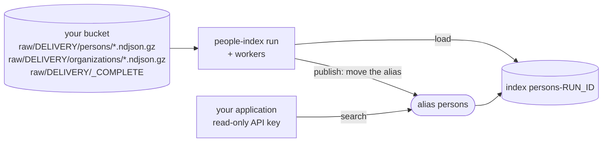

# Integrating people-index

For a team that runs people-index inside its own product: what you provide, how to deploy it
into your cluster, which settings matter, how your application reads the result, how to operate
and upgrade it, where its limits are, and what stays stable between versions.
[ARCHITECTURE.md](ARCHITECTURE.md) is the contract this guide summarises and
[OPERATIONS.md](OPERATIONS.md) the runbook; where they say more, they win.

## The shape of an integration

You deliver two gzipped NDJSON feeds, persons and organizations, to an S3-compatible bucket. A
run (one coordinator and any number of workers) reads one delivery, joins every person with the
organizations its roles point at, loads the documents into a fresh Elasticsearch index
`<alias>-<run_id>`, checks it, and moves the alias onto it in one atomic request. Your
application only ever queries the alias, with a read-only identity.



The bucket is also the only coordination medium: plans, commits, leases and the intermediate
data live under `runs/` and `_run-leases/` next to the inputs. There is no database and no
long-running service; a run is a batch job that ends when the alias has moved (or the run has
failed, leaving the alias where it was).

## Requirements

**Feeds.** Gzipped NDJSON, one envelope per line, `{"id": ..., "record": {...}}`, in files
named `*.ndjson.gz` under `persons/` and `organizations/` (the contract is in
[The feed contract](#the-feed-contract) below). With `PI_DELIVERY=<name>` a run reads
`raw/<name>/` instead of `raw/`; write `raw/<name>/_COMPLETE` once the last file is in place and
set `PI_REQUIRE_COMPLETE_MARKER=true` so a run never plans a half-written delivery. A delivery is
never changed after it is marked complete: put replacements in a new one
([ARCHITECTURE.md, Feed delivery contract](ARCHITECTURE.md#feed-delivery-contract),
[OPERATIONS.md, A feed delivery](OPERATIONS.md#a-feed-delivery)). Feeds whose field names differ
from the built-in ones are described by a schema file and a mapping file
([OPERATIONS.md, Feed schema](OPERATIONS.md#feed-schema)).

**An S3-compatible object store with conditional writes.** Commits and leases are
create-if-absent (`If-None-Match: *`) and update-if-match (`If-Match: <etag>`) PUTs; the store
must answer 412 when one does not hold, with exactly one winner under concurrency
([ADR 0003](adr/0003-object-store-commits-and-leases.md)). SeaweedFS 4.48 is tested on every
pull request; AWS S3 documents both conditions and is what the production example targets, but
no test in this repository runs against it. To check your store, run the same conformance and
lease cases CI runs against SeaweedFS (`scripts/check-s3.sh`), pointed at a scratch bucket of
yours (they leave test objects under `conformance-*` and `lease-test-*`):

```bash
export PI_TEST_S3_ENDPOINT=https://s3.example.com PI_TEST_S3_BUCKET=your-scratch-bucket
export AWS_ACCESS_KEY_ID=... AWS_SECRET_ACCESS_KEY=... AWS_REGION=...
cargo test --locked -p pi-store --test conformance -- s3:: --nocapture
cargo test --locked -p pi-coord --test leases -- leases_hold_on_a_real_s3_endpoint --exact --nocapture
```

Every case must pass, and none may print `PI_TEST_S3_ENDPOINT is not set` (that is a skip).
The local filesystem store (`file://` or a bare path) is for one machine: it cannot run the
distributed executor or hold the run lock.

**Elasticsearch 9.** Tested with 9.5.5 only; several extraction rules follow behaviour observed
on 9.5.5 ([ARCHITECTURE.md, The data](ARCHITECTURE.md#the-data)), so another version may skip
values differently. The pipeline needs one user with role `people-index-writer` (cluster
`monitor`, all privileges on `<alias>` and `<alias>-*`, nothing else) and your application one
with `people-index-reader` (`read` and `view_index_metadata` on the alias only); both are in
[deploy/k8s/base/elasticsearch/roles.yml](../deploy/k8s/base/elasticsearch/roles.yml), and
`deploy/compose/scripts/es-users.sh` creates the same roles through the security API. Block
automatic creation of `<alias>-*` indexes (`action.auto_create_index: "-persons-*,+*"`, as both
deployments do), so a bulk request can never recreate a lost run index with a default
mapping.

**Kubernetes or one host.** The Kustomize deployment uses ECK 3.5.0 for Elasticsearch, is
validated against the Kubernetes 1.35 schemas, and the local cluster pins k3s v1.35.5; other
versions are not tested. The schedule component uses a CronJob with `timeZone` and an Indexed
Job with a `podFailurePolicy`. The monitoring component needs the Prometheus Operator CRDs and
kube-state-metrics. Elasticsearch nodes need `vm.max_map_count` of at least 1048576 for the
production example (262144 for compose). On a single host, Docker Compose runs the same shape
([OPERATIONS.md, Compose](OPERATIONS.md#compose)).

**The image.** Built from the `Dockerfile` (`make image` builds `people-index:local`): a
distroless image running as uid 65532 with `people-index` as its entrypoint and metrics on 9464.
Push it to your own registry and refer to it by digest. Signed release images are planned (#68);
no release has been tagged yet. Building from source needs Rust 1.90 or later.

## Deploying into your own cluster

Start from [deploy/k8s/overlays/production-example](../deploy/k8s/overlays/production-example):
an external S3 bucket instead of the in-cluster store, six data nodes across three zones,
monitoring and snapshots. CI renders and schema-checks it. Copy it to
`deploy/k8s/overlays/<yours>` in your checkout (the Job renderer looks for overlays there), then
change:

1. **Image**: `IMAGE` in `jobs.vars`, your registry's image pinned as `name:tag@sha256:...`.
2. **Bucket and endpoint**: `PI_STORE_URL`, `PI_S3_ENDPOINT` and `AWS_REGION` in
   `config-patch.yaml`, and the `s3.client.default.*` entries in `elasticsearch-patch.yaml` (the
   snapshot client). The bucket must exist already.
3. **Credentials**: the env files in `secrets/` (git-ignored) become Secrets
   `pipeline-es-credentials`, `s3-credentials`, `snapshot-s3-credentials` and
   `es-exporter-credentials`. `deploy/k8s/gen-secrets.sh <yours>` fills every file with random
   values, which suits the two Elasticsearch passwords; in `s3.env` and `snapshot-s3.env` put the
   real keys of your two bucket identities instead (random keys match no identity), or use
   workload identities where your cloud has them. In a real cluster prefer an operator that
   creates the same Secret names (the overlay's comments).
4. **Sizing**: node counts, heap, memory and storage in `elasticsearch-patch.yaml`; the per-task
   memory settings in `config-patch.yaml` and `WORKERS`, `WORKER_MEMORY`, `WORKER_CONCURRENCY`
   in `jobs.vars`, changed together ([OPERATIONS.md, Sizing](OPERATIONS.md#sizing)).
5. **Elasticsearch URL and CA**: the overlays run Elasticsearch through ECK in the
   `people-index` namespace, and the Jobs mount the CA from Secret `es-es-http-certs-public`
   (key `ca.crt`). To bring your own HTTP certificate, follow the comment in the overlay's
   `kustomization.yaml`. Using an Elasticsearch cluster outside the overlay is not shipped as an
   example: it means removing the `Elasticsearch` resource, setting `PI_ES_URL`, providing
   that Secret (or editing the Job templates), and admitting the cluster's address in the
   `pipeline-egress` NetworkPolicy, whose Elasticsearch rule allows port 9200 only to the
   in-cluster `es` pods.
6. **Network**: the pipeline's egress patch admits HTTPS outside the private ranges; narrow it to
   your endpoint where you can. Ingress is denied by default (see
   [Querying the result](#querying-the-result-from-your-application)).

Install ECK and apply the overlay, naming your context on every command:

```bash
make eck KUBE_CONTEXT=<your-context>
kubectl --context <your-context> apply --server-side -k deploy/k8s/overlays/<yours>
kubectl --context <your-context> -n people-index wait elasticsearch/es \
  --for=jsonpath='{.status.health}'=green --timeout=15m
```

Then start a run, or let the schedule component start them:

```bash
make run OVERLAY=<yours> KUBE_CONTEXT=<your-context>      # renders the Jobs, waits for the run
make verify OVERLAY=<yours> KUBE_CONTEXT=<your-context>   # VERIFY_SOURCE=summary in jobs.vars
```

(`make deploy-local` is for the local overlay only: it waits for the in-cluster store.)
[deploy/k8s/README.md](../deploy/k8s/README.md) has the layout, the security model and the
names other parts rely on.

**Optional components** (add them under `components:` in your overlay):

- `components/monitoring`: the Elasticsearch exporter, ServiceMonitors, a PodMonitor for the
  pipeline's `:9464` and alert rules. kube-state-metrics must export the Job labels
  (`--metric-labels-allowlist=jobs=[app.kubernetes.io/name,app.kubernetes.io/component]`), or
  the Job alerts cannot match; `PeopleIndexJobLabelsMissing` fires when it does not
  ([OPERATIONS.md, Pipeline alerts](OPERATIONS.md#pipeline-alerts)).
- `components/snapshots`: an S3 snapshot repository in a separate bucket with its own
  credentials, and SLM policy `nightly` (01:30 UTC, kept 14 days). Set `SNAPSHOT_BUCKET` on Job
  `snapshot-bootstrap` (`snapshot-bucket-patch.yaml`); provision the bucket yourself
  ([OPERATIONS.md, Snapshot storage](OPERATIONS.md#snapshot-storage)).
- `components/schedule`: a daily CronJob (02:00 UTC) whose Indexed Job runs one coordinator and
  three workers; patch its schedule, image, resources and deadline for your cluster
  ([OPERATIONS.md, Scheduled runs](OPERATIONS.md#scheduled-runs)).

**Running the image alone.** Everything is one binary with five commands (plus `scheduled`, which
the CronJob uses to pick `run` or `worker` from its Job index). Most flags are also a `PI_*`
variable; the exceptions are `stage`'s stage name and `--task`, and `verify`'s `--digest` and
`--page-size`:

| command | what it does |
|---|---|
| `people-index run` | the coordinator: plans, runs or hands out every stage, publishes; resumes an existing `PI_RUN_ID` |
| `people-index worker` | claims tasks of `PI_RUN_ID` (or the newest run) until it is published or failed |
| `people-index stage <name> --run-id R [--task T]` | one task or one stage, for debugging |
| `people-index verify [--source summary] [--digest]` | checks the alias against a run's `summary.json` (real feeds) or datagen's counts |
| `people-index datagen --persons N --organizations M --files F --seed S` | synthetic feeds and their expected counts, for trying it out |

A distributed run is one `run` with `PI_EXECUTOR=distributed` plus any number of `worker`
processes with the same `PI_RUN_ID`, all with the same settings. For example, one process doing
everything:

```bash
docker run --rm -v "$PWD/es-ca.crt:/ca/ca.crt:ro" \
  -e PI_STORE_URL=s3://your-bucket/people-index -e PI_S3_ENDPOINT=https://s3.example.com \
  -e AWS_REGION=eu-west-1 -e AWS_ACCESS_KEY_ID -e AWS_SECRET_ACCESS_KEY \
  -e PI_ES_URL=https://es.example.internal:9200 -e PI_ES_CA_CERT=/ca/ca.crt \
  -e PI_ES_USERNAME=pipeline -e PI_ES_PASSWORD \
  -e PI_DELIVERY=batch-20261028 -e PI_REQUIRE_COMPLETE_MARKER=true \
  people-index:local run
```

## Configuration in brief

The settings an integrator most often changes. The full table is
[ARCHITECTURE.md, Configuration](ARCHITECTURE.md#configuration); byte sizes take suffixes
(`256MiB`), durations humantime (`30m`). The defaults are the binary's; the Kubernetes base
ConfigMap (`deploy/k8s/base/kustomization.yaml`) and the production example set several of them
differently (`PI_EXECUTOR=distributed`, smaller or larger task memory).

| setting | default | what for |
|---|---|---|
| `PI_STORE_URL` | `file://./store` | the run store, `s3://bucket/prefix` |
| `PI_S3_ENDPOINT`, `AWS_ACCESS_KEY_ID`, `AWS_SECRET_ACCESS_KEY`, `AWS_REGION` | unset; `us-east-1` | an S3-compatible endpoint (path-style requests) and its credentials |
| `PI_INPUT_URL` | `<store>/raw` | inputs under a separate prefix |
| `PI_DELIVERY`, `PI_REQUIRE_COMPLETE_MARKER` | unset, false | which delivery a run reads, and whether `_COMPLETE` is required |
| `PI_SCHEMA_FILE`, `PI_MAPPING_FILE` | the built-in ones | feeds with other field names |
| `PI_ES_URL`, `PI_ES_CA_CERT` | `http://localhost:9200`, unset | the cluster and the CA to trust |
| `PI_ES_USERNAME` + `PI_ES_PASSWORD`, or `PI_ES_API_KEY` | unset | the pipeline's identity (one or the other) |
| `PI_ALIAS` | `persons` | the alias your application queries; the run's index is `<alias>-<run_id>` |
| `PI_EXECUTOR`, `PI_CONCURRENCY` | `local`, CPUs | one process or coordinator plus workers; tasks per process |
| `PI_TASK_MEMORY_BYTES`, `PI_BUFFER_BYTES`, `PI_SEGMENT_TARGET_BYTES` | 512 MiB, 256 MiB, 64 MiB | memory per task ([Sizing](OPERATIONS.md#sizing)) |
| `PI_SENDERS_PER_WORKER`, `PI_BULK_MAX_BYTES` | 2, 8 MiB | bulk pressure on the cluster |
| `PI_INDEX_SHARDS`, `PI_INDEX_REPLICAS` | 2 per data node, 1 | the published index |
| `PI_MAX_MALFORMED` | 1000 | malformed lines tolerated per feed before the run fails |
| `PI_PUBLISH_MIN_SHARE`, `PI_PUBLISH_MAX_UNRESOLVED`, `PI_PUBLISH_ALLOW_EMPTY_ORGANIZATIONS` | 0.9, 0.25, false | publish refuses an index much smaller than the one it replaces, too many unresolved organizations, or none indexed |
| `PI_PUBLISH_HEALTH`, `PI_HEALTH_TIMEOUT` | `green`, `30m` | the health publish waits for |
| `PI_RETAIN_RUNS` | 3 | published runs whose stage data is kept; 0 keeps all |
| `PI_METRICS_ADDR`, `PI_LOG_FORMAT` | `0.0.0.0:9464`, `json` | Prometheus endpoint (`off` disables), log format (`RUST_LOG` filters) |

Changing `PI_ALIAS` also changes the names in `roles.yml` (both roles), the
`action.auto_create_index` exclusion on every Elasticsearch node set, the two alias alert rules
([Pipeline alerts](OPERATIONS.md#pipeline-alerts)) and `SLM_INDICES` of the snapshot bootstrap
(default `persons*`); compose follows `PI_ALIAS` by itself.

## The feed contract

- **Envelope**: `{"id": <u64 or a string of decimal digits within u64>, "record": {...}}`, one
  per line. Other envelope fields, such as `updated_at`, are ignored. A missing or invalid `id`
  or `record`, a duplicate `id` or `record` key, a blank line, or a line longer than
  `PI_MAX_LINE_BYTES` (8 MiB) is malformed.
- **Records**: the built-in person and organization fields are listed in
  [ARCHITECTURE.md, The data](ARCHITECTURE.md#the-data). Unknown fields pass through to
  `_source` untouched but are not indexed (`dynamic: false`).
- **Organization references**: each `roles[]` entry may carry `organization_id` (the same id rule;
  null or absent means no organization). The document gets the full record of every distinct
  resolved organization in `organizations[]`, `roles[].organization_resolved`, and
  `unresolved_organization_ids[]` when some did not resolve.
- **Ids and order**: duplicate ids resolve to the last record in feed order, files sorted by key
  and then by line, whatever the partition or worker count. Name files so that later data sorts
  later. `"7"` and `7` are the same id.
- **Quarantined** (kept out of the index, written to `runs/<run_id>/quarantine/` with file, line,
  kind and a sample; kinds `syntax`, `envelope`, `record`, `too_long`, `document_too_large`): a
  malformed line, a mapped field of the wrong JSON kind, a number longer than 1000 characters,
  a document larger than `PI_MAX_DOCUMENT_BYTES` (8 MiB, clamped to `PI_BULK_MAX_BYTES` minus
  4 KiB so every kept document fits one bulk request). Past `PI_MAX_MALFORMED` malformed lines
  per feed the run fails; oversized documents do not count towards it.
- **Kept and counted** (in the extract counters of `summary.json`): `values_ignored_by_index`,
  values Elasticsearch will skip under `ignore_malformed` (`"n/a"` in `followers`; the document is
  indexed without them and lists the field in `_ignored`); `fields_not_indexed`, unknown
  top-level keys of kept records; `records_with_repeated_keys`, records stored with only the last
  occurrence of a repeated key.
- **Schema and mapping files**: `PI_SCHEMA_FILE` renames the envelope keys, the references and the
  checked fields; `PI_MAPPING_FILE` is the matching index mapping. Both are checked against each
  other at startup and pinned in the run's plan
  ([OPERATIONS.md, Feed schema](OPERATIONS.md#feed-schema)). The output names
  (`organizations`, `unresolved_organization_ids`, `organization_resolved`) stay fixed.

## Querying the result from your application

Query the alias (`persons` by default), never an index by name: each run's index is named after
the run and is deleted once a newer run has published.

- **Identity**: a user with role `people-index-reader`, or better an API key created by an
  administrator with a role descriptor limited to the alias. The commands to create, use and
  rotate one are in [OPERATIONS.md, Querying the index](OPERATIONS.md#querying-the-index).
  The reader cannot read `<alias>-*` indexes by name, write, or see cluster state.
- **Paging**: on 9.5.5 an alias-only reader can open a point in time on the alias, but searching
  with it returns 403 (PIT search needs `read` on the underlying indexes). Page with
  `search_after` without a PIT, or with `from` and `size`; a publish between two pages can change
  the results.
- **Network**: in Kubernetes, ingress to Elasticsearch is denied by default. The label
  `people-index.io/es-client: "true"` admits pods in the `people-index` namespace only; an
  application elsewhere, or an ingress, needs a NetworkPolicy of your own admitting TCP 9200
  from it. The production example's `kustomization.yaml` describes the certificate and exposure
  options.
- **Fields**: the mapping is
  [crates/pi-es/src/mapping.json](../crates/pi-es/src/mapping.json), with its reasons in
  [mapping.md](../crates/pi-es/src/mapping.md). In short: names and titles are `text` with a
  `.keyword` sub-field (`first_name`, `last_name`, `roles.title`, `roles.organization_name`,
  `organizations.name`), and `full_name` is searchable but not in `_source`; codes and
  enumerations (`country`, `city`, `industry`, `skills`, `organizations.keywords`, ...) are
  `keyword`; ids and counts are `long`; `roles` and `organizations` are `object`, not `nested`,
  so a query cannot require two conditions to hold in the same role; `summary` and the
  descriptions are stored but not indexed; `memberships`, `educations` and other nested
  structures are `enabled: false` (returned, not searchable).
- **Between runs**: every run publishes a complete new index built from one delivery; there are
  no partial updates. The document `_id` is the person id, so a person keeps the same `_id` as
  long as your feed keeps its id; a person missing from a delivery is missing from the index that
  run publishes. The alias moves in one request, so a search sees either the old index or the new
  one. A failed run never touches the alias. Publish refuses an index with fewer than
  `PI_PUBLISH_MIN_SHARE` (0.9) of the previous document count, and never replaces a newer run's
  index with an older one (for run ids that begin with their UTC start time, as generated ids
  and the Makefile's do; a hand-picked id is not ordered, and its stage data is not cleaned up).

## Operating it

- **Runs**: by the schedule component, by hand
  (`make run OVERLAY=<yours> KUBE_CONTEXT=<your-context>`, or a Job created from the CronJob,
  [Scheduled runs](OPERATIONS.md#scheduled-runs)), or `people-index run` anywhere. A failed run
  resumes from its commits with the same run id
  (`make resume RUN_ID=<id> OVERLAY=<yours> KUBE_CONTEXT=<your-context>`); start a new run
  instead once a newer run has published
  ([Resuming a failed run](OPERATIONS.md#resuming-a-failed-run)).
- **Run lease**: on a store with conditional writes, a coordinator holds
  `_run-leases/<alias>.json` for the whole run, so a second run for the same alias is refused
  (`a run is already in progress`) while the first is live; the same run id may resume.
- **Alerts and metrics**: the monitoring component's rules cover failed and stalled Jobs, an
  alias whose index is old or missing, and Elasticsearch itself; set the thresholds for your
  cadence ([Pipeline alerts](OPERATIONS.md#pipeline-alerts)). Each published run writes
  `runs/<run_id>/summary.json` with its counts; `people-index verify --source summary` checks the
  alias against it.
- **Retention**: after each publish, stage data of published runs older than the newest
  `PI_RETAIN_RUNS` (3) is removed; plans, summaries, quarantine and the inputs stay. Do not put a
  lifecycle rule on `runs/` ([Sizing, Run store](OPERATIONS.md#sizing)).
- **Backups and restore**: the snapshots component snapshots `persons*` nightly into its own
  bucket ([Snapshot storage](OPERATIONS.md#snapshot-storage)). Restoring an index and moving the
  alias back to it follows [Rollback and restore](OPERATIONS.md#rollback-and-restore); the compose
  end-to-end run exercises those steps with a drill. Because deliveries are immutable and kept, the
  index can also be rebuilt by a new run, which is also how to go back to an earlier delivery:
  a new run with `PI_DELIVERY` set to it (lower `PI_PUBLISH_MIN_SHARE` if that delivery is much
  smaller).
- **Upgrades**: build or pull the new image, set it in `jobs.vars` (and in the CronJob patch if
  you use the schedule), and re-apply the overlay if its manifests changed. Upgrade between
  runs: let a run finish with the image it started with, or abandon it and start a new run. A
  run pins its feed schema and index mapping in `plan.json`, and any task with other files
  fails the run for good, so a schema or mapping change is always a new run. A new mapping
  reaches your application at the publish that moves the alias, all at once.

## Limits

- **Scale tested**: no benchmark has been run; there are no throughput or memory numbers. The
  distributed run is tested end to end only on Docker Compose: CI's end-to-end on `main` runs
  20,000 persons and 5,000 organizations in 4 files per feed with two workers on one runner
  (`make compose-run` defaults to 200,000 and 50,000). The production example's sizing is
  reasoned, not measured ([README, Limitations](../README.md#limitations)).
- **Kubernetes**: no Kubernetes cluster has run it yet. The manifests pass schema validation
  and their parts were checked against Elasticsearch and SeaweedFS containers, but ECK
  reconciliation, NetworkPolicy enforcement and a distributed run on Kubernetes have not been
  exercised.
- **Windows**: the local `file://` store fails a write now and then with "Access is denied"
  (#43); use the S3 store for anything that matters. Linux is not affected.
- **One alias per run store**: retention counts runs across the whole store prefix, and a
  `worker` without `PI_RUN_ID` follows the newest run in the store. Give each alias (each
  deployment) its own `PI_STORE_URL` prefix.
- **One coordinator per run id**: the run lease excludes other runs of the alias, not a second
  coordinator for the same id; do not start one.
- **Clocks**: lease expiry is wall-clock time plus 5 s; large drift repeats work but keeps the
  result correct.
- **A count mismatch at publish** fails the run for good; start a new run (the old index keeps
  serving).
- **Popular organizations** grow the intermediate `joined` data, since each reference carries
  the organization's record ([ADR 0002](adr/0002-partitioned-hash-join.md)).
- **Built-in only**: `datagen` writes the built-in schema, so `verify --source expected` is for
  synthetic feeds; counter and summary names keep the built-in words.
- **Losing the bucket** loses the runs' intermediate state; a run then starts over.

## Compatibility policy

people-index follows [semantic versioning](https://semver.org/) for the surface below; the
workspace version is in `Cargo.toml`. Until 1.0, a minor release (0.x to 0.y) may make a breaking
change and a patch release (0.x.y) does not; from 1.0, only a major release does. Every breaking
change is listed in the release notes with what to do about it.

What counts as breaking:

- **(a) The feed contract**: the envelope (`id`, `record`) and the id rule; the delivery layout
  (`raw/<delivery>/persons/`, `organizations/`, `_COMPLETE`, `*.ndjson.gz`); the built-in person,
  role and organization fields and the JSON kinds they accept; what is quarantined rather than
  kept; feed-order last-wins; the schema-file format (its keys and kinds). A feed accepted by one
  version and quarantined or refused by the next is a break; accepting more is not.
- **(b) The index and the document your application reads**: the alias-only publishing model;
  the built-in mapping's fields and types and the builder's output fields (`organizations`,
  `roles[].organization_resolved`, `unresolved_organization_ids`, `_id` as the person id); the
  privileges of `people-index-reader`. Removing, renaming or retyping a field, or making it
  unsearchable, is a break. Adding a field, or indexing one that was stored only, is not a
  break, as long as no record kept before is now quarantined ((a)). A new name the builder
  writes into the document is a break.
- **(c) Settings**: the `PI_*` variables and their meaning; a default that changes what is
  published, what is quarantined or when publish refuses (`PI_ALIAS`, `PI_PUBLISH_*`,
  `PI_INDEX_REPLICAS`, `PI_MAX_MALFORMED`, `PI_MAX_LINE_BYTES`, `PI_MAX_DOCUMENT_BYTES`,
  `PI_BULK_MAX_BYTES` (the document limit is clamped to it minus 4 KiB), `PI_RETAIN_RUNS`).
  Other sizing defaults (task memory, buffers, segment sizes, senders, partitions) may change in
  a minor release with a note, since they change resources, not results. A new setting whose
  default keeps the old behaviour is not a break.
- **(d) The command line**: the commands (`run`, `worker`, `stage`, `verify`, `datagen`,
  `scheduled`), their flags, the JSON they print on stdout, and the exit codes: 0 success; 1 a
  failure, a failed check or an invalid setting; 2 a command line that does not parse (unknown
  flag, malformed value) or a scheduled worker's failure; 143 when `run`, `worker` or `stage`
  stop on SIGTERM or Ctrl-C.
- **(e) The run store**: the run-id timestamp format that orders runs, and the files earlier
  runs left that later runs read: `plan.json`, `state.json`, `publish.json`, `summary.json`,
  the run lease, and the stage data directories (`runs/<id>/<stage>/data/`) and task leases
  (`runs/<id>/<stage>/_lease/*.json`) that retention inspects and removes. A new version keeps
  reading them, so publish, retention and `verify` keep working across an upgrade; a release
  that changes the data or lease layout says so, and earlier runs' stage data is then left for
  removal by hand. Resuming a run with a different version than the one that planned it is
  supported only when the release notes say so. A plan pins its schema and mapping, and that
  pin keeps meaning the same files.
- **The image**: `people-index` as the entrypoint, uid 65532, metrics on port 9464, and a
  distroless base with no shell (nothing may rely on one inside the container).
- **Monitoring**: the metric names and labels in
  [ARCHITECTURE.md, Metrics](ARCHITECTURE.md#metrics) and the fields of `summary.json`; adding
  is not a break.
- **Elasticsearch**: dropping a tested Elasticsearch version is a break.

Not covered: the Rust crates' APIs (every crate is `publish = false`; they are not a library),
log messages and their fields, the segment format and the contents of the stage data, and
the files under `deploy/`, which are starting points you copy and own (their changes are in the
release notes, but an overlay of yours may need adjusting in any release).
